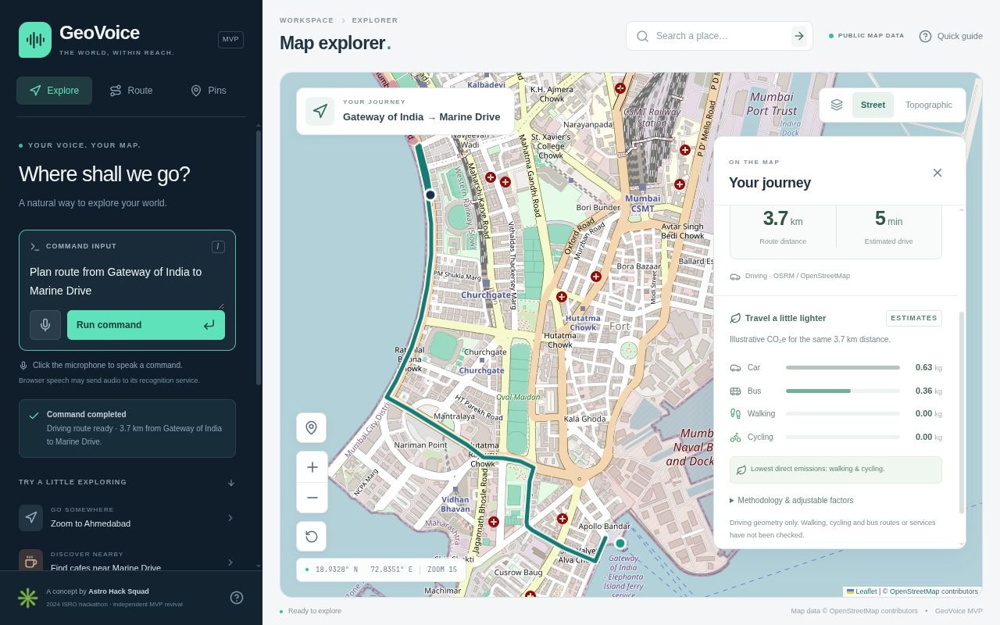
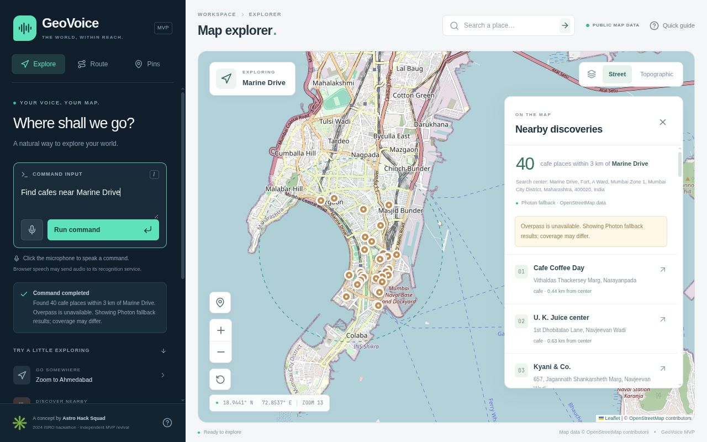
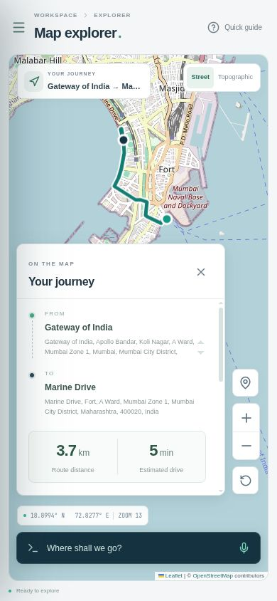

# GeoVoice

**Explore the world through natural language.** A working, map-first GIS MVP with text commands, optional browser speech, nearby-place discovery, driving routes and transparent carbon estimates.

## Context and attribution

This is an independent MVP revival of the **Astro Hack Squad** collaborative concept associated with the 2024 ISRO Bharatiya Antariksh Hackathon problem: “Develop a library or proof-of-concept for voice-enabled user-interface for geospatial map based web applications.” The original concept documents propose accessibility, local voice processing and sustainability features; they are not evidence that those features were historically completed or formally evaluated.

The original team's collaborative contribution is acknowledged in the interface and here. This implementation claims no competition award, published paper, research validation or exclusive ownership of the original concept. No project-wide license is asserted on behalf of the original team. Third-party libraries and map data retain their own licenses.

The supplied repository could not be cloned: GitHub returned repository not found over SSH and HTTP 404 for its HTTPS page. Following the user's explicit fallback authorization, this was created as a standalone directory, **without initializing Git**.

## Run locally

Requires Node.js **22.12 or newer** and npm on Linux/macOS. Tested with Node 26.8.2. No sign-in, API key or paid subscription is required.

```bash
cd /home/thewitch/geovoice-mvp-samrudhi
npm ci
npm run dev
```

Open **http://127.0.0.1:4173**. The server listens on loopback only. Stop it with Ctrl+C. If port 4173 is occupied, use `PORT=4175 npm run dev`.

For the production build:

```bash
npm run build
npm start
```

Run either the development or production server on the selected port, not both. `npm start` serves `dist/` and the geographic API together; opening `dist/index.html` directly or using a static-only preview will not provide the API.

```bash
npm test
npm run typecheck
```

Dependencies are local in `node_modules/`; npm's cache is `.cache/npm/`. Runtime caches and temp files are inside `.cache/` and `tmp/`. Build output is `dist/`; screenshots and verification evidence are in `artifacts/`. No parent-workspace configuration or existing repository is required. The directory itself is persistent; command history, user pins and map session state are in memory and reset on reload.

## Working features

- Interactive React Leaflet map starting in Mumbai, with panning, zoom, coordinates, resize handling and attribution.
- Real OpenStreetMap street and OpenTopoMap topographic basemaps. Topographic tiles can take several seconds to load.
- Typed deterministic command parser and a reusable GIS executor, without an LLM dependency.
- Explicit location searches, up to five selectable matches, literal coordinates, cached results, and clear no-result errors. Exact place-name matches outrank partial matches. Searches have a soft Mumbai viewbox bias; names outside it remain supported. Add a city/state/country when a name is ambiguous.
- User markers from named commands or the pin tool followed by a map click. Popups show source and coordinates. Remove individual markers, the most recent marker, or all user markers. Search and POI markers use separate styles.
- Nearby cafes, restaurants, hospitals, parks, hotels and tourist attractions, with an adjustable command radius, result list, approximate distance, coordinates and addresses when present. Selecting a result focuses the map.
- Live OSRM driving polylines, origin/destination context, distance, provider-estimated duration and a clear-route action. A route form and text commands share the same executor.
- Car, bus, walking and cycling **illustrative emissions comparisons**, with adjustable car/bus factors and an explained formula. Only driving geometry is requested.
- Browser speech adapter with explicit microphone activation, listening/processing states, final-transcript submission, stop/retry, timeout, permission/no-speech errors and text fallback.
- Command examples, bounded recent history, structured processing/result feedback, cancelable searches, help dialog, keyboard focus and a responsive mobile drawer/results sheet. Errors and cancellation remain visible on mobile while the drawer is closed.

## Demo commands

Type a command and press Enter, or click **Run command**. Shift+Enter inserts a new line; `/` focuses the input. Suggested commands run immediately. After you activate the microphone, the final recognized transcript runs once through the same command handler. Interim text never executes.

| Purpose | Examples |
| --- | --- |
| Zoom | `Zoom in` · `Zoom out` · `Zoom to Ahmedabad` |
| Navigate/search | `Go to Pune` · `Find Mumbai` · `Find São Paulo, Brazil` |
| Coordinates | `Zoom to 19.076, 72.8777` |
| Markers | `Add marker at Gateway of India` · `Remove marker` · `Remove marker at Pune` · `Clear markers` |
| Basemaps | `Show street map` · `Show road layer` · `Show topographic map` · `Hide topographic map` |
| Nearby | `Find cafes near Marine Drive` · `Show hospitals near Andheri` · `Find parks within 3 km of Powai` · `Find restaurants near Bandra` |
| Other POIs | `Find hotels near Jaipur` · `Find tourist attractions near Mumbai` |
| Route | `Plan route from Gateway of India to Marine Drive` · `Clear route` |
| Reset | `Reset map` |

Arbitrary valid names are supported; these are examples, not hardcoded coordinates. A named navigation/POI/route command uses the first ranked geocoding result and shows the resolved location. Search results offer alternate matches. Named marker removal matches the marker's displayed name, case-insensitively. `Remove marker` removes the most recent user pin.

## Architecture

```text
Typed command / speech transcript / UI action
    → parseCommand → discriminated Command union
    → executeCommand(command, GisAdapter, GeographicServices, AbortSignal)
    → Leaflet adapter → map + React state → user feedback/history

React → same-origin /api/* → local Node proxy
                              ├─ Nominatim: geocoding
                              ├─ Overpass → Photon fallback: bounded POI queries
                              └─ OSRM: driving route geometry
```

`src/commands/` contains parsing and execution; it imports no React or Leaflet code. `src/gis/adapter.ts` defines the GIS and service contracts; `src/gis/leafletAdapter.ts` connects those contracts to Leaflet. To integrate another GIS library, implement `GisAdapter` and provide it to `executeCommand`; speech and parsing do not need to change. `src/voice/speechAdapter.ts` produces text and status callbacks, so an on-device transcriber can later replace it. `src/config/emissions.ts` owns the factors and calculation.

The small `server/` proxy is needed for application-wide provider rate limiting, persistent caching, identification, validation and configurable endpoints. It is also the production static server. It is intended for one locally running demo, not as a public API or production mapping service.

## External services, policies and privacy

**Public Nominatim has strict usage restrictions.** Review the [Nominatim policy](https://operations.osmfoundation.org/policies/nominatim/) before use or deployment: maximum one request per second across the application, clear attribution and application identification, caching, no autocomplete, bulk geocoding or confidential inputs. The local proxy serializes calls with at least 1.1 seconds between starts, coalesces duplicate requests and caches location results for seven days. Only explicit user submissions cause searches. Run a single server instance; multiple independently running copies do not coordinate quotas. A public deployment requires a deliberate provider/usage review, rather than assuming the public service is unlimited.

Street tiles come directly from [OpenStreetMap](https://operations.osmfoundation.org/policies/tiles/), with visible contributor attribution and normal browser caching. No bulk tile downloads, offline prefetch or service worker is used. [OpenTopoMap](https://opentopomap.org/about) is a separate topographic layer, attributed to OSM contributors, SRTM and OpenTopoMap under CC-BY-SA. It is not satellite imagery.

Overpass queries use a default 3 km radius, permit 100 m–10 km, retrieve at most 100 OSM elements and display up to 40 normalized nearby results sorted by straight-line distance. They are bounded, cached for ten minutes and serialized. They are not exhaustive listings. See the [Overpass public-instance guidance](https://wiki.openstreetmap.org/wiki/Overpass_API#Public_Overpass_API_instances). Availability is not guaranteed; the default service reported capacity errors during verification. If Overpass fails, the proxy uses the [Photon public API](https://github.com/komoot/photon#demo-server) for a category-filtered, radius-bounded reverse search, then independently checks category, coordinates and distance. The panel prominently labels Photon fallback results and their potentially different coverage. Up to 40 live or cached records are shown; no fake POIs are substituted. Failed Overpass requests trigger a one-minute cooldown before another primary attempt. Photon also permits only reasonable usage and has no uptime guarantee; deploy your own or an appropriate hosted service for larger usage.

[OSRM](https://project-osrm.org/docs/v5.24.0/api/) provides driving routes based on OpenStreetMap. Public demo infrastructure has no uptime guarantee. Route results are cached for ten minutes. Estimated duration does not include live traffic. The application's bounded persistent service cache stores at most 250 successful responses and stays in `.cache/service-cache.json`; no audio or accounts are stored.

Requests have timeouts. New commands abort obsolete browser requests and prevent their results from changing the map. The proxy may finish an already-started shared upstream request and cache its result; canceling a UI command does not rewind a request already sent to a public service.

Optional configuration: copy `.env.example` to `.env` **inside this directory** and edit `PORT`, `GEOCODING_URL`, `OVERPASS_URL`, `PHOTON_URL` or `ROUTING_URL`; restart the server afterward. Compatible endpoints can be changed without rebuilding the frontend. Do not point `ROUTING_URL` at a walking/cycling profile: the application intentionally identifies its routes as driving.

Browser speech has [limited support and may use remote recognition](https://developer.mozilla.org/en-US/docs/Web/API/SpeechRecognition). It is **not guaranteed to work offline or process locally**. Microphone permission and recognition service availability vary by browser. Listening starts only when you activate the microphone; a final transcript executes once and listening stops. Type commands if voice is unavailable. Geographic providers receive the place names or coordinates you search; avoid personal or confidential locations.

## Carbon methodology

```text
estimated kg CO₂e = driving route distance in km × illustrative factor in kg/km
```

Defaults are **illustrative assumptions**, not sourced transport measurements or locally validated factors: car 0.171 kg/km (one occupant), bus 0.097 kg/passenger-km, walking 0, cycling 0. Car and bus factors can be edited in the route panel, or all defaults changed in `src/config/emissions.ts`. This simple comparison excludes traffic, vehicle technology, lifecycle emissions, food-related emissions and local energy mix. It assumes the same driving distance for comparisons; actual walking, cycling or bus distances may differ. Zero means zero **direct operational** emissions under this model. It does not establish bus availability, route accessibility, or an optimized low-emission journey. Estimates appear only after a valid route distance is returned.

## Limitations and future work

Public services and internet access are required. The parser supports documented grammar, not unrestricted conversation. Speech recognition with a real microphone still requires a user/browser check. Nearby search depends on Overpass or its explicitly labeled Photon fallback. Verification retrieved 40 real cafes near Marine Drive through the fallback; Overpass itself was at capacity. Session pins/history do not persist. No highway overlay, satellite layer, traffic, transit service, accessible-route certification or route optimization is claimed.

Future work only: on-device Whisper/WebGPU, an OpenLayers adapter, broader command interpretation, reliable hosted geographic providers, saved journeys, transit data, QGIS integration and raster analysis. Accounts, reservations, turn-by-turn navigation and package publication are outside this MVP.

## Screenshots and verification

Actual desktop/mobile captures are stored in `artifacts/`. The route and nearby-search captures demonstrate live provider data:







See [docs/verification.md](docs/verification.md) for executed checks, feature status and remaining external-service limitations.
